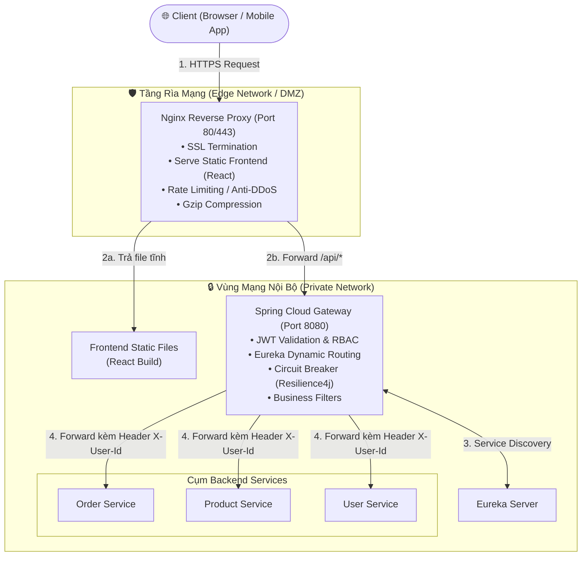

# BÁO CÁO BÀI TẬP: NGINX REVERSE PROXY, API GATEWAY & LOAD BALANCING

- **Họ và tên / Sinh viên**: NamNT
- **Repository**: [NamNT2942003/11](https://github.com/NamNT2942003/11)
- **Hệ thống**: Nginx Reverse Proxy, Security & Load Balancing Platform

---

## MỤC LỤC
1. [Bài 1: Cấu hình Nginx Reverse Proxy Cơ Bản](#bài-1-vận-dụng-cơ-bản---cấu-hình-nginx-reverse-proxy-cơ-bản)
2. [Bài 2: Định tuyến Request đến API Gateway (Path-based Routing)](#bài-2-vận-dụng-cơ-bản---định-tuyến-request-đến-api-gateway)
3. [Bài 3: Bảo mật bằng HTTPS với Let's Encrypt](#bài-3-vận-dụng-chuyên-sâu---bảo-mật-bằng-https-với-lets-encrypt)
4. [Bài 4: Tối ưu hóa và Reload cấu hình không gián đoạn (Zero-downtime)](#bài-4-vận-dụng-chuyên-sâu---tối-ưu-hóa-và-reload-cấu-hình-không-gián-đoạn)
5. [Bài 5: Phân tích Kiến trúc - Spring Cloud Gateway vs Nginx](#bài-5-phân-tích---api-gateway-spring-cloud-vs-reverse-proxy-nginx)
6. [Bài 6: Load Balancing và Subdomain Routing Toàn Diện](#bài-6-sáng-tạo---load-balancing-và-subdomain-routing-toàn-diện)

---

## Bài 1: Vận dụng cơ bản - "Cấu hình Nginx Reverse Proxy Cơ Bản"

### 1. File cấu hình Nginx (`/etc/nginx/sites-available/default`)
```nginx
server {
    listen 80;
    listen [::]:80;

    server_name domain.com www.domain.com; # Hoặc để _ nếu dùng IP

    location / {
        # Proxy toàn bộ request vào cổng 80 chuyển hướng tới localhost:3000
        proxy_pass http://localhost:3000;

        proxy_http_version 1.1;
        proxy_set_header Upgrade $http_upgrade;
        proxy_set_header Connection 'upgrade';
        proxy_set_header Host $host;
        proxy_cache_bypass $http_upgrade;
        proxy_set_header X-Real-IP $remote_addr;
        proxy_set_header X-Forwarded-For $proxy_add_x_forwarded_for;
        proxy_set_header X-Forwarded-Proto $scheme;
    }
}
```

### 2. Giải thích ý nghĩa của chỉ thị `proxy_pass`
- `proxy_pass` là chỉ thị cốt lõi của module `ngx_http_proxy_module` trong Nginx.
- **Ý nghĩa & Chức năng**: Thiết lập Nginx đóng vai trò là một **Reverse Proxy**. Khi nhận request từ client tại cổng 80, Nginx mở một kết nối mới tới upstream server nội bộ được định nghĩa trong `proxy_pass` (ở đây là `http://localhost:3000`), lấy dữ liệu phản hồi từ ứng dụng React và trả về cho client.
- **Lợi ích**: Giúp che giấu port nội bộ `:3000`, tăng cường bảo mật và giúp người dùng chỉ cần gõ `http://domain.com` thay vì phải chỉ định port.

### 3. Trả lời câu hỏi bẫy: Mã lỗi HTTP khi ứng dụng React ở port 3000 bị sập
- **Mã lỗi trả về**: **`502 Bad Gateway`**.
- **Giải thích**:
  - Nginx vẫn đang chạy bình thường trên cổng 80 nên bản thân nó không bị lỗi `500 Internal Server Error`.
  - Khi cố gắng kết nối tới backend tại `localhost:3000`, do tiến trình React đã chết, cổng 3000 bị đóng, hệ điều hành trả về `Connection Refused` (RST packet).
  - Vì proxy không thể kết nối hoặc nhận được phản hồi hợp lệ từ upstream server, theo chuẩn HTTP Nginx sẽ trả về mã lỗi **`502 Bad Gateway`**.

---

## Bài 2: Vận dụng cơ bản - "Định tuyến Request đến API Gateway"

### 1. File cấu hình Nginx với 2 block `location`
```nginx
server {
    listen 80;
    listen [::]:80;

    server_name domain.com www.domain.com;

    # 1. Định tuyến các request API tới Backend API Gateway (Port 8080)
    location /api/ {
        proxy_pass http://localhost:8080;

        proxy_http_version 1.1;
        proxy_set_header Host $host;
        proxy_set_header X-Real-IP $remote_addr;
        proxy_set_header X-Forwarded-For $proxy_add_x_forwarded_for;
        proxy_set_header X-Forwarded-Proto $scheme;
    }

    # 2. Định tuyến các request còn lại (Frontend React - Port 3000)
    location / {
        proxy_pass http://localhost:3000;

        proxy_http_version 1.1;
        proxy_set_header Upgrade $http_upgrade;
        proxy_set_header Connection 'upgrade';
        proxy_set_header Host $host;
        proxy_set_header X-Real-IP $remote_addr;
        proxy_set_header X-Forwarded-For $proxy_add_x_forwarded_for;
        proxy_set_header X-Forwarded-Proto $scheme;
        proxy_cache_bypass $http_upgrade;
    }
}
```

### 2. Trả lời câu hỏi bẫy: Tại sao phải truyền Header `X-Forwarded-For`?
- **Nếu không truyền `X-Forwarded-For`**: Backend sẽ **chỉ nhìn thấy IP của chính Nginx** (thường là `127.0.0.1` hoặc IP mạng nội bộ).
  - *Lý do*: Tầng TCP/IP của Backend chỉ nhìn thấy địa chỉ nguồn (Source IP) của kết nối TCP trực tiếp, mà kết nối đó được tạo bởi Nginx.
- **Tại sao bắt buộc phải truyền**:
  - **Rate Limiting / Chống Brute Force**: Backend cần IP thực của client để giới hạn tần suất gọi API theo từng người dùng. Nếu chỉ thấy `127.0.0.1`, việc chặn 1 IP có thể làm sập toàn bộ người dùng khác.
  - **Audit Log & Truy vết bảo mật**: Ghi log chính xác người dùng nào (ở IP nào) đã thực hiện giao dịch thanh toán, đăng nhập hay thao tác dữ liệu.
  - **GeoIP**: Phục vụ xác định vị trí địa lý của khách hàng.

---

## Bài 3: Vận dụng chuyên sâu - "Bảo mật bằng HTTPS với Let's Encrypt"

### 1. Chuỗi lệnh cài đặt `certbot` trên Ubuntu
```bash
sudo apt update
sudo apt install -y certbot python3-certbot-nginx
```

### 2. Lệnh cấp phát SSL tự động và cấu hình Nginx
```bash
sudo certbot --nginx -d api.my-ecommerce.com
```

### 3. Mẫu cấu hình Nginx viết bằng tay cho HTTPS (Port 443 & Redirect 301)
```nginx
# 1. Block HTTP (Port 80): Redirect 301 sang HTTPS
server {
    listen 80;
    listen [::]:80;
    server_name api.my-ecommerce.com;

    return 301 https://$host$request_uri;
}

# 2. Block HTTPS (Port 443)
server {
    listen 443 ssl http2;
    listen [::]:443 ssl http2;
    server_name api.my-ecommerce.com;

    # Đường dẫn trỏ tới chứng chỉ SSL của Let's Encrypt
    ssl_certificate /etc/letsencrypt/live/api.my-ecommerce.com/fullchain.pem;
    ssl_certificate_key /etc/letsencrypt/live/api.my-ecommerce.com/privkey.pem;

    # Best practices tối ưu bảo mật SSL/TLS
    ssl_protocols TLSv1.2 TLSv1.3;
    ssl_prefer_server_ciphers on;
    ssl_ciphers HIGH:!aNULL:!MD5;
    ssl_session_cache shared:SSL:10m;
    ssl_session_timeout 1d;

    location / {
        proxy_pass http://localhost:8080;

        proxy_http_version 1.1;
        proxy_set_header Host $host;
        proxy_set_header X-Real-IP $remote_addr;
        proxy_set_header X-Forwarded-For $proxy_add_x_forwarded_for;
        proxy_set_header X-Forwarded-Proto https;
    }
}
```

### 4. Trả lời câu hỏi bẫy: Tự động gia hạn (Auto-renew) chứng chỉ Let's Encrypt (90 ngày)
- Mặc định khi cài đặt Certbot, hệ thống đã kích hoạt `certbot.timer` trong systemd (`systemctl status certbot.timer`).
- Kiểm thử quy trình gia hạn giả lập:
  ```bash
  sudo certbot renew --dry-run
  ```
- **Thiết lập Cronjob thủ công chuẩn Production**:
  Mở crontab root bằng lệnh `sudo crontab -e` và thêm:
  ```cron
  0 3 * * * certbot renew --quiet --deploy-hook "systemctl reload nginx"
  ```
  - Chạy lúc 3:00 sáng mỗi ngày.
  - `--deploy-hook "systemctl reload nginx"`: **Bắt buộc** để Nginx nạp chứng chỉ mới vào RAM ngay khi chứng chỉ được cập nhật.

---

## Bài 4: Vận dụng chuyên sâu - "Tối ưu hóa và Reload cấu hình không gián đoạn"

### 1. Đoạn cấu hình bổ sung `client_max_body_size` và block `gzip`
```nginx
# 1. Cho phép upload file lên tới 10MB (Khắc phục lỗi 413 Request Entity Too Large)
client_max_body_size 10M;

# 2. Bật nén Gzip tối ưu tốc độ tải trang
gzip on;
gzip_vary on;
gzip_proxied any;
gzip_comp_level 6; # Mức nén tối ưu giữa dung lượng và CPU
gzip_min_length 1024; # Không nén file dưới 1KB

# Các định dạng cần nén
gzip_types
    text/plain
    text/css
    text/xml
    text/javascript
    application/json
    application/javascript
    application/x-javascript
    application/xml
    application/xml+rss
    image/svg+xml;

gzip_disable "msie6";
```

### 2. Trả lời câu hỏi bẫy: `systemctl restart` vs `systemctl reload` trên Production
1. **Lệnh bắt buộc phải gõ trước tiên**:
   ```bash
   sudo nginx -t
   ```
   Lệnh này kiểm tra cú pháp toàn bộ cấu hình mà không ảnh hưởng tới tiến trình đang chạy.

2. **Khác biệt chí mạng giữa `restart` và `reload`**:
   - `systemctl restart nginx`: **Kill toàn bộ tiến trình Nginx ngay lập tức**. Toàn bộ kết nối của người dùng đang thanh toán hoặc upload avatar sẽ bị ngắt đột ngột (drop connection). Nếu file config có lỗi cú pháp, Nginx sẽ chết hẳn và website sập toàn diện (Outage).
   - `systemctl reload nginx` (**Zero-downtime / Graceful Reload**): Gửi tín hiệu `SIGHUP` tới Master process. Nginx khởi tạo các Worker mới với cấu hình mới cho các request mới, đồng thời để các Worker cũ phục vụ nốt các kết nối đang dang dở cho tới khi hoàn tất. Nếu cấu hình lỗi, Nginx bỏ qua và tiếp tục chạy với cấu hình cũ, không gây downtime.

---

## Bài 5: Phân tích - "API Gateway (Spring Cloud) vs Reverse Proxy (Nginx)"

### 1. Phản biện đề xuất "Bỏ Nginx, mở cổng 80 trực tiếp cho Spring Cloud Gateway"
Đề xuất bỏ Nginx là một sai lầm nghiêm trọng trong kiến trúc hệ thống Production:
- **Nginx (Edge Network)**: Viết bằng C, theo mô hình Event-driven Non-blocking, tiêu tốn cực ít tài nguyên (chỉ vài chục MB RAM) để xử lý hàng chục nghìn kết nối đồng thời. Đóng vai trò là "lá chắn thép" giải quyết SSL/TLS Termination, phục vụ file tĩnh cực nhanh (`sendfile`), và hấp thụ các cuộc tấn công DDoS, Slowloris.
- **Spring Cloud Gateway (Application Layer)**: Viết bằng Java/Spring, chạy trên JVM. Có thế mạnh về hiểu biết nghiệp vụ sâu: xác thực JWT, phân quyền RBAC, tích hợp Service Discovery (Eureka/Consul), dynamic routing, và Circuit Breaker (Resilience4j). Nếu để Spring Cloud Gateway trực tiếp hứng traffic Internet, CPU của JVM sẽ bị bão hòa bởi quá trình mã hóa/giải mã SSL và dễ bị tràn bộ nhớ (OOM) khi gặp lưu lượng tấn công lớn.

### 2. Sơ đồ luồng dữ liệu chuẩn (Two-Tier Architecture)



👉 **Kết luận**: Giữ nguyên mô hình 2 tầng: Nginx ở rìa mạng để chặn đạn, Spring Cloud Gateway ở bên trong xử lý logic nghiệp vụ.

---

## Bài 6: Sáng tạo - "Load Balancing và Subdomain Routing Toàn Diện"

### File cấu hình Nginx (`/etc/nginx/sites-available/my-ecommerce.conf`)
```nginx
# ==============================================================================
# UPSTREAM BLOCK: LOAD BALANCING BACKEND (ROUND ROBIN & HEALTH CHECK)
# ==============================================================================
upstream backend_api_cluster {
    # 3 server backend chia tải Round Robin
    server 127.0.0.1:8080 max_fails=3 fail_timeout=10s;
    server 127.0.0.1:8081 max_fails=3 fail_timeout=10s;
    server 127.0.0.1:8082 max_fails=3 fail_timeout=10s;

    keepalive 32;
}

# ==============================================================================
# 1. SUBDOMAIN QUẢN TRỊ: admin.my-ecommerce.com
# ==============================================================================
server {
    listen 80;
    listen [::]:80;
    server_name admin.my-ecommerce.com;

    location / {
        # Trỏ tới container React Admin chạy ở port 4000
        proxy_pass http://127.0.0.1:4000;

        proxy_http_version 1.1;
        proxy_set_header Upgrade $http_upgrade;
        proxy_set_header Connection 'upgrade';
        proxy_set_header Host $host;
        proxy_set_header X-Real-IP $remote_addr;
        proxy_set_header X-Forwarded-For $proxy_add_x_forwarded_for;
        proxy_set_header X-Forwarded-Proto $scheme;
    }
}

# ==============================================================================
# 2. DOMAIN CHÍNH: my-ecommerce.com
# ==============================================================================
server {
    listen 80;
    listen [::]:80;
    server_name my-ecommerce.com www.my-ecommerce.com;

    # 2.1. Định tuyến API đến cụm upstream Load Balancing
    location /api/ {
        proxy_pass http://backend_api_cluster;

        proxy_http_version 1.1;
        proxy_set_header Connection "";
        proxy_set_header Host $host;
        proxy_set_header X-Real-IP $remote_addr;
        proxy_set_header X-Forwarded-For $proxy_add_x_forwarded_for;
        proxy_set_header X-Forwarded-Proto $scheme;

        # Cơ chế Failover tự động: Chuyển ngay request sang server khác nếu server hiện tại chết/lỗi
        proxy_next_upstream error timeout http_502 http_503 http_504;
        proxy_next_upstream_timeout 10s;
        proxy_next_upstream_tries 3;

        proxy_connect_timeout 5s;
        proxy_send_timeout 30s;
        proxy_read_timeout 30s;
    }

    # 2.2. Định tuyến các trang còn lại tới Frontend React (Port 3000)
    location / {
        proxy_pass http://127.0.0.1:3000;

        proxy_http_version 1.1;
        proxy_set_header Upgrade $http_upgrade;
        proxy_set_header Connection 'upgrade';
        proxy_set_header Host $host;
        proxy_set_header X-Real-IP $remote_addr;
        proxy_set_header X-Forwarded-For $proxy_add_x_forwarded_for;
        proxy_set_header X-Forwarded-Proto $scheme;
    }
}
```

### Cơ chế hoạt động:
1. **Phân định tên miền (Virtual Host)**: Nginx đọc header `Host` để phân luồng chính xác giữa `admin.my-ecommerce.com` (port 4000) và `my-ecommerce.com`.
2. **Cơ chế Failover khi Server 8080 sập**:
   - Khi `8080` bị tắt, request gặp lỗi kết nối sẽ được `proxy_next_upstream` lập tức thử lại trên `8081` hoặc `8082` mà người dùng không gặp lỗi.
   - Khi `8080` tích lũy đủ 3 lần lỗi (`max_fails=3`), Nginx tạm thời gạch tên `8080` khỏi danh sách điều phối trong 10 giây (`fail_timeout=10s`), 100% request được chia đều cho 2 server còn lại.
